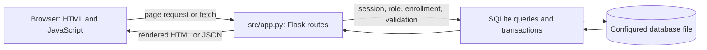

# Backend map and P0 / M5 audit

Audit date: 2026-11-15. Starting main: `33cc07d`. Scope requested: five P0 stories and M5 backend runtime; US12/US13 expansion is excluded.

## Is there a backend?

**Yes. EduSurvey already has a real Flask backend, SQL queries and SQLite persistence.** It shares `src/` with the templates/static assets. `src/app.py` handles HTTP requests, sessions, authorization, business validation and transactions; it is not a collection of UI mock responses. `data/edusurvey.db` is the generated development database and is intentionally not committed.



| File | Responsibility |
|---|---|
| [src/app.py](../src/app.py) | Main backend: routes, login/session checks, student evaluation queries, question loading, submission writes, lecturer feedback and related APIs. Most business logic currently lives here. |
| [src/schema.sql](../src/schema.sql) | Tables, relationships, uniqueness and CHECK constraints for users/courses/evaluations/questions/responses/answers. |
| [src/init_db.py](../src/init_db.py) | Initial schema and synthetic demo accounts/data. `--m5-demo` explicitly prepares a NEW DB with upcoming open deadlines and a fresh student submission slot. Existing production databases cannot be reset with this script. |
| [src/runtime.py](../src/runtime.py) | Production configuration, connection lifetime, public `/health`, safe request/error telemetry. Added by this audit. |
| [src/status.py](../src/status.py) | Standalone status helper and strict Due soon threshold. The list route also contains status calculation; existing tests cover both. |
| [src/feedback_classifier.py](../src/feedback_classifier.py), [src/feedback_queries.py](../src/feedback_queries.py) | Topic classification/query helpers. Some topic logic also lives inline in app.py; these files do not replace route authentication. |
| [tools/backup_database.py](../tools/backup_database.py) | SQLite online backup with integrity checks, no overwrite, owner-only backup permissions. Added by this audit. |
| [gunicorn.conf.py](../gunicorn.conf.py), [Procfile](../Procfile), [requirements-prod.txt](../requirements-prod.txt) | Production WSGI entrypoint and dependencies; this is a deployable runtime definition, not evidence of an actual deployment. |
| `src/templates/`, `src/static/` | UI: rendered pages and JS/CSS. JavaScript calls the Flask APIs; required validation is still enforced server-side. |
| `tests/` | Isolated backend, database and real-browser regressions. |

## The five P0 workflows

| Story | Main backend functions in app.py | HTTP entrypoints | Server-side responsibility |
|---|---|---|---|
| US01 login | `login`, `current_user`, `login_required` | `POST /api/auth/login`, `GET /api/auth/me` | Verify password hash against users; clear/replace session, record user_id/role, reject bad credentials and unauthorized roles. |
| US02 assigned evaluations | `get_student_evaluations` | `GET /api/evaluations` | Join enrollment for current student; exclude other students' courses; compute Active / Due soon / Completed / Closed, strict `<24h` and expired-at-equality. |
| US03 answer/submit | `get_evaluation_questions`, `create_submission` | `GET /api/evaluations/<id>/questions`, `POST /api/submissions` | Verify student/enrollment/open/deadline/duplicate rules; validate required answers, rating/text types and limits; save response+answers transactionally. |
| US04 lecturer feedback | `get_lecturer_course_feedback`, `lecturer_feedback_list`, `lecturer_feedback_detail` | `GET /api/courses/<id>/feedback`, `/lecturer/feedback`, `/lecturer/feedback/<id>` | Enforce lecturer/course assignment, include submitted responses only, return counts/ratings/comments. |
| US11 sign-out | `logout`, `login_required` | `POST /api/auth/logout`; protected pages/APIs | Clear current session; browser page navigation reaches login; APIs keep JSON 401 and wrong-role access 403. |

Example: selecting Submit triggers `complete_evaluation.js` → `POST /api/submissions` → server validates the data and inserts into `responses`/`response_answers` → commits → returns 201/submitted → UI shows a receipt. Reload reads the database again; the result is not stored only in browser memory.

## Audit findings and changes

| Finding on starting main | Implemented correction | Verification / boundary |
|---|---|---|
| Login/duplicate API messages differed from approved requirements | Canonical `Invalid email or password.` and `You have already completed this evaluation.` in both duplicate endpoints (#214) | Existing credential nodes retained; P0C-05/06 check duplicates and saved-data preservation. |
| Anonymous HTML access returned JSON 401 | HTML/no-Accept page requests redirect 302 to `/login`; explicit JSON clients and APIs retain JSON 401 (#215) | P0C-08 covers real login/logout for student/lecturer/admin pages. Existing denial scenarios are retained with deliberate HTML-only expectation updates. |
| Topic/ranking/statistics endpoints lacked authentication/ownership | Shared lecturer+course-assignment guard on all three aggregate endpoints | BE-03 checks anonymous, student, administrator, unassigned lecturer and assigned lecturer for each endpoint. |
| Offset-aware ISO deadlines could crash list/question comparisons | Compare against current time in the deadline timezone; retain strict 24h/expiry equality | BE-12 uses a fixed UTC instant, +07:00 deadlines and both sides/equality of the boundary across list/questions/submission. |
| No public `/health` | Real read-only SQLite/schema/integrity check; 200 when successful, sanitized 503 otherwise; no-store | BE-01 checks good, missing, empty and corrupt temporary databases. Missing database is not auto-created. This does not measure future write capacity or deployed latency. |
| Database connections did not enforce foreign keys or close on context exit | `PRAGMA foreign_keys=ON`; transaction context commits/rolls back and closes; `mode=rw` refuses missing DB | BE-06 verifies rollback and closed connection. |
| Runtime used a development secret/default DB with no production guard | Production mode requires explicit secret and absolute DB path; Secure/HttpOnly/SameSite cookies; Gunicorn entrypoint; debug off by default | BE-05; real local Gunicorn smoke verifies secure-cookie headers, readiness failure/recovery and HTML redirect. |
| No backup helper or safe initial demo mode | Online backup/integrity checks, no overwrite, mode 0600; new-DB M5 demo mode; production reset refusal | BE-07/08/09/11; temporary backup/restored-copy round trip. No real database was modified for the failure test. |
| Request monitoring absent and error text could reveal internals | Endpoint/method/status/server duration JSON events; sanitized database/unexpected error events; no query/body/cookie/token/IP logging | BE-02/04/10 use private markers and assert they never enter responses/logs. Raw production access logging is disabled. |

## Verify on your machine

For the existing local walkthrough:

```bash
python -m pip install -r requirements-dev.txt
python -m playwright install chromium
python tools/run_student_demo.py
```

Open `http://127.0.0.1:5000/`; use the demo accounts shown on login. The launcher uses a temporary database. On its separate process `/health` should report `{"database":"ok","status":"ok"}`. A development session over plain HTTP is appropriate for this local walkthrough; production sessions require HTTPS.

For automated checks:

```bash
python -m pytest -q
python -m pytest -q tests/test_backend_runtime.py tests/test_auth.py tests/test_submission_workflow.py
```

Linux browser installation: `python -m playwright install --with-deps chromium`. No manually running server or production DB is required. The pre-existing browser fixture starts its own temporary loopback server.

## Remaining work, not claimed complete

- Public HTTPS hosting, configured persistent volume/database, platform log viewer/alerts, protected-main deployment gating, deployment/rollback rehearsal and public phone/private-desktop timing require #204/#205/#206/#207/#208/#209/#210 owners and platform configuration. Runtime code being present does not prove these deployed acceptance criteria.
- Copied pre-logout signed-cookie replay remains the unresolved #216 policy/design question. Clearing today's browser session is not server-side cookie revocation.
- US12 full administration remains P1 and outside this audit; `/account` is a role landing, not an administration implementation. US13 already has a create-evaluation API, but full P1 UI/acceptance is not certified here.
- SQLite is intended for one application instance on durable storage. Horizontal scaling, hosted PostgreSQL migration, comprehensive CSRF policy/rate limiting, deeper service/repository separation remain design/hardening considerations, not completed release claims.

Actual verification: **169 tests passed in 54.47s** locally, with all 128 existing scenarios retained and 41 new variants. Stronger duplicate-preservation assertions passed in a subsequent focused run (2 passed in 0.12s). A real temporary Gunicorn production-mode smoke also passed. These are local/CI checks, not deployed availability or performance evidence.

See [backend runtime handover](backend-runtime.md) for environment variables, launch/backup/restore instructions and monitoring definitions, and [testing.md](testing.md) for actual test evidence.
