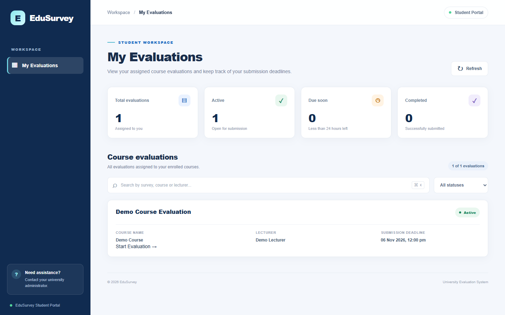
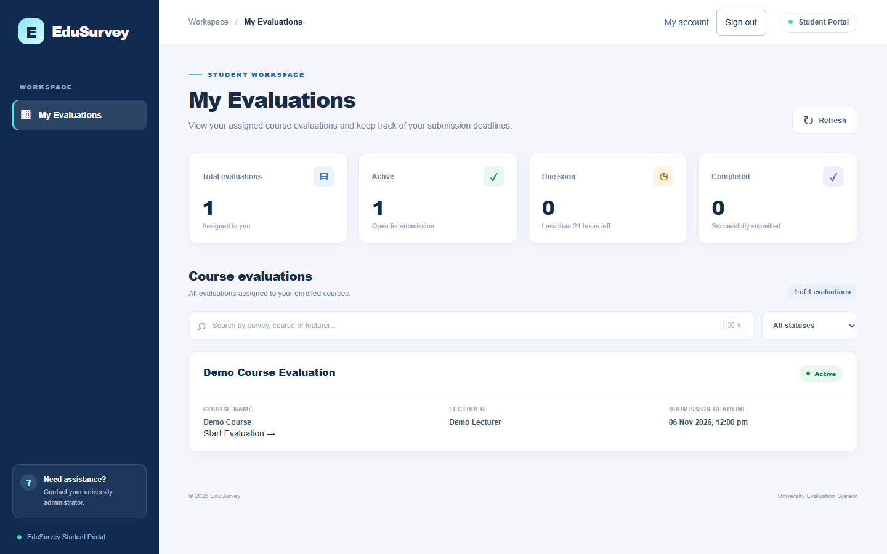
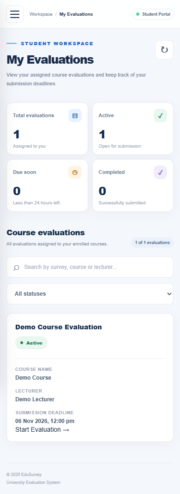
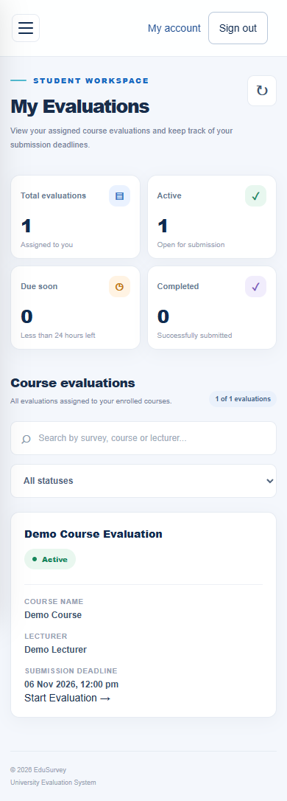
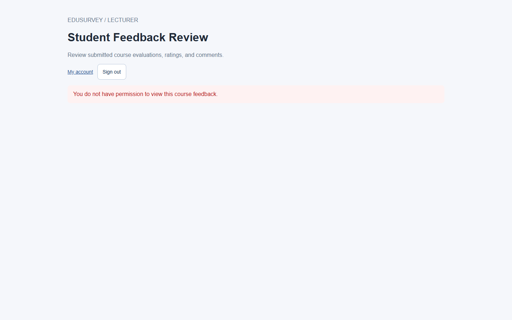
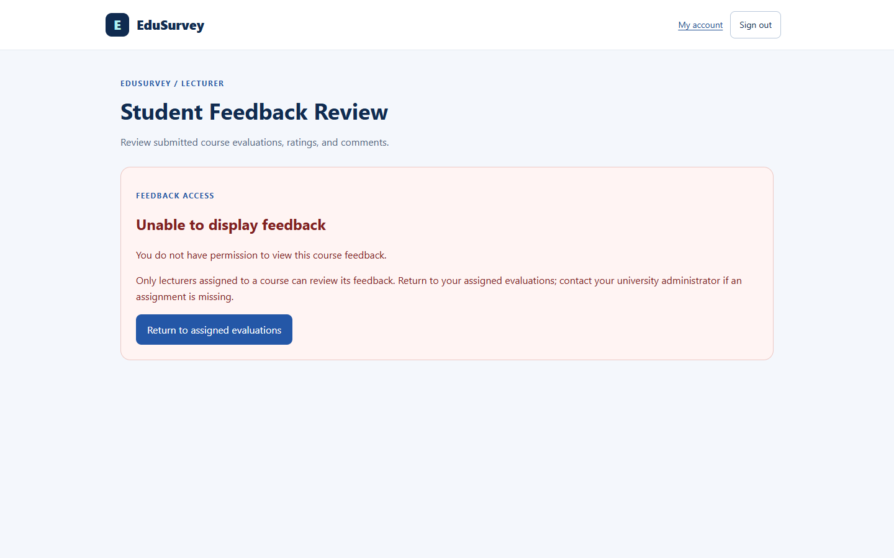
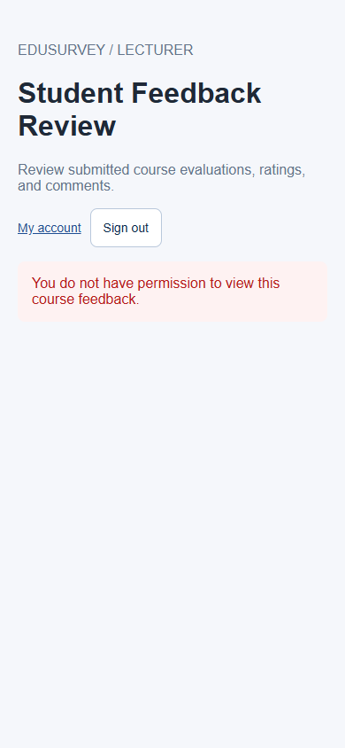
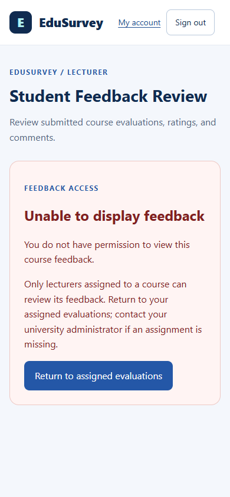

# M3 UI improvement evidence register - #203

Status (2026-11-15): **local comparison captured; M3 feedback attribution and
released-UI verification pending**. Parent #200; implementation dependencies
#201 / PR #218 and #202 / PR #219. This evidence does not complete #203 yet.

## Sources located and missing

| Source | What it establishes | Limit |
|---|---|---|
| [M3 UI PR #161 review](https://github.com/SE-FDA-NEU-AI66B/software-group4-topicB2/pull/161#pullrequestreview-5910147509) | Actual peer review asks for design-document consistency and working SVG links; distinguishes implemented screens from proposed lecturer/logout wireframes | Does not request either specific UI improvement below |
| [M3 README PR #162 review](https://github.com/SE-FDA-NEU-AI66B/software-group4-topicB2/pull/162#pullrequestreview-5910149876) | Actual peer review asks that routes/navigation match implementation and backend-only features not be described as available frontend | Context for navigation verification; no verified causal link to these two UI changes |
| [M3 task #129](https://github.com/SE-FDA-NEU-AI66B/software-group4-topicB2/issues/129) | Requires error explanations and next actions | A requirement/task, not instructor/user feedback |
| [M3 docs commit b74dd3a](https://github.com/SE-FDA-NEU-AI66B/software-group4-topicB2/commit/b74dd3a) and [M3 README merge a279514](https://github.com/SE-FDA-NEU-AI66B/software-group4-topicB2/commit/a279514) | Real historical documentation and SVG wireframes | Wireframes are not screenshots of a running application |
| `docs/sprint-log.md`, `docs/test-results-m3.md`, Git history and GitHub issue/PR comments/reviews searched | Existing Sprint 1 feedback and historical M3 implementation limitations | No original instructor/user M3 UI feedback identifying these improvements found |

The GitHub search for repository issues containing M3 returned #127, #129,
#161, #162, #203 and #211; relevant issue/review threads and #200/#201/#202/
#204/#205/#210 were also inspected. No public release URL was present in the
reviewed README/evidence, and the GitHub deployments API returned an empty list.
An empty deployments list does not prove there is no externally hosted app.
Original M3 feedback and the running release URL/SHA have been requested from
the task owner. They must be supplied or located before attribution/closure.

## Candidate 1 - visible student sign-out

The same `/evaluations` screen gains visible My account / Sign out controls.
Before: snapshot `5a52af698d4ddf1662af0516f86a1878e35c2fd6`, before #201.
After: snapshot `dff0de81103ace1b937dd3a3ffdcbea94cb57f7f` on main.
Implementation: [PR #218](https://github.com/SE-FDA-NEU-AI66B/software-group4-topicB2/pull/218).
The screenshot runner verified no Sign out button before; after it clicked Sign
out, reached `/login`, and confirmed `/api/auth/me` returned 401 on both widths.

| Laptop before | Laptop after |
|---|---|
|  |  |

| Phone before | Phone after |
|---|---|
|  |  |

Feedback attribution: **pending original M3 feedback**. The #162 review is
documented context, not proof that a reviewer requested this control.

## Candidate 2 - actionable lecturer permission recovery

The same `/lecturer/feedback/2` denial keeps HTTP 403 and the existing permission
message, and adds an explanation of course assignment plus Return to assigned
evaluations. Before: snapshot `2cb2b05496444858ae712db6ac98f4c88803a0e7`, before
#202. After: `dff0de81103ace1b937dd3a3ffdcbea94cb57f7f`.
Implementation: [PR #219](https://github.com/SE-FDA-NEU-AI66B/software-group4-topicB2/pull/219).
Both widths passed 403/hidden-title assertions. After recovery, the assigned list
returned 200 and exactly one Review feedback link. The old screen already had
HTML denial; this change is recovery guidance/navigation, not JSON-to-HTML denial.

| Laptop before | Laptop after |
|---|---|
|  |  |

| Phone before | Phone after |
|---|---|
|  |  |

Feedback attribution: **pending original M3 feedback**. #129 is a real M3
requirement; it is not relabeled as feedback. The pre-change commit is a later
pre-M5 baseline, not an original M3 presentation screenshot.

## Capture provenance and reproduction

All eight PNGs are newly captured **local reconstructions**, not images captured
during M3 and not screenshots of the public release. Each baseline uses the
unmodified `src` tree exported from its pinned commit. Test-only database/config/
clock setup is external to that exported source. A fresh temporary database has
synthetic Demo Student/Lecturer, Demo Course/Evaluation and a hidden unassigned
course. No real account, password, token, personal record or database is captured.
An authenticated synthetic session is injected; this runner does not test login.
Every image was visually inspected. Browser chrome/cookies and login fields are
outside the captured page, and the unassigned title is asserted absent.

Viewport sizes are 1440x900 and 390x844 at device scale 1. PNGs are full-page, so
phone image height can exceed viewport height. T=2026-11-04T12:00:00 and deadline
2026-11-06T12:00:00 are fixed. External requests/fonts are blocked identically in
both snapshots, so local fallback fonts can differ from an eventual release.
All eight measured screens had no horizontal overflow. Four JSON manifests in
`docs/evidence/203/` record exact commits, routes, status codes, viewport and SHA256.

Executed on Windows / Python 3.12.6 / Playwright 1.65.2 with installed Chrome:

```powershell
python -m pip install -r requirements-dev.txt
$env:PLAYWRIGHT_CHROMIUM_EXECUTABLE = 'C:\Program Files\Google\Chrome\Application\chrome.exe'
python tools/capture_ui_comparison.py --after dff0de8
python -m ruff check tools/capture_ui_comparison.py
git diff --check
```

Capture completed: four snapshot/scenario jobs, eight images, two successful
sign-out checks and two successful recovery checks; changed-script Ruff passed.
The first capture attempt incorrectly expected old lecturer denial to be JSON;
inspection established it was already HTML. The assertion was corrected to the
actual missing recovery link and the entire capture command then passed.
No product code changed and no full pytest run is claimed for this docs task.

## Five-minute P0 segment plan - not yet a verified rehearsal

Reserve 0:00-3:30 for normal P0 click-through, persistence and the chosen business
rule rejection. At 3:30-4:05 show candidate 1 before/after, then click Sign out and
show login. At 4:05-4:45 show candidate 2 before/after, explain assignment, and
click the recovery link back to the assigned list. Leave 4:45-5:00 as buffer.
These are a proposed time budget, not recorded rehearsal timings. Capture the
same released routes with seeded accounts in a fresh desktop/mobile context,
record the actual five-minute rehearsal, and bind each improvement to the
confirmed original feedback before presenting them as completed #203 evidence.

## Completion gate

- [x] Two distinct local UI differences, pinned before/after sources and implementation PRs
- [x] Sanitized phone/laptop images, manifests and reproducible capture command
- [ ] Original M3 feedback source mapped explicitly to each selected improvement
- [ ] Owner confirms candidates match that feedback (or replaces them and recaptures)
- [ ] Public HTTPS URL and deployed SHA supplied/verified; after screens match release
- [ ] Actual five-minute P0 rehearsal includes both improvements and all required P0 steps
- [ ] Independent teammate recorded review/approval

Keep #203 open until these gates are met. Deployment/seed-data evidence belongs
with #204/#205/#210; no deployment or self-approval is created by this document.
