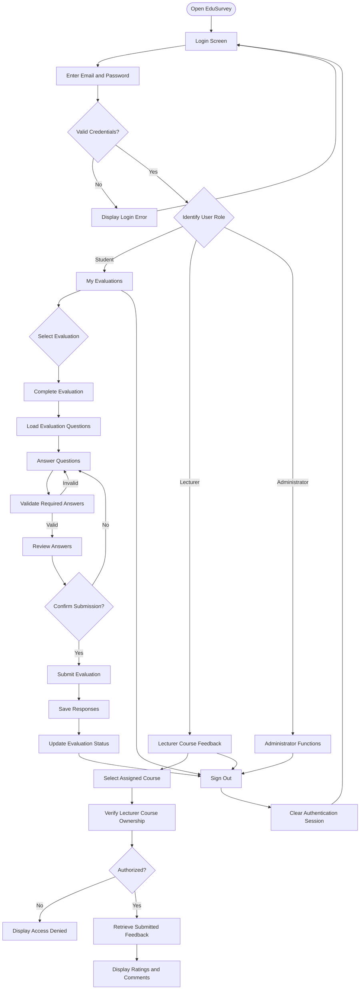
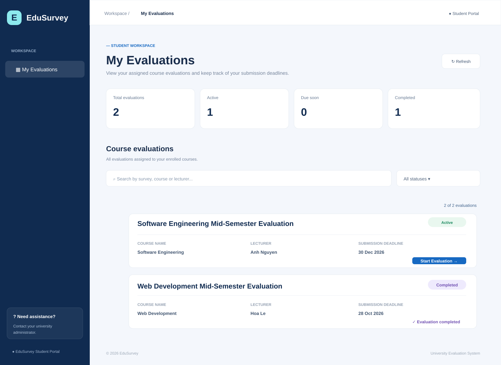
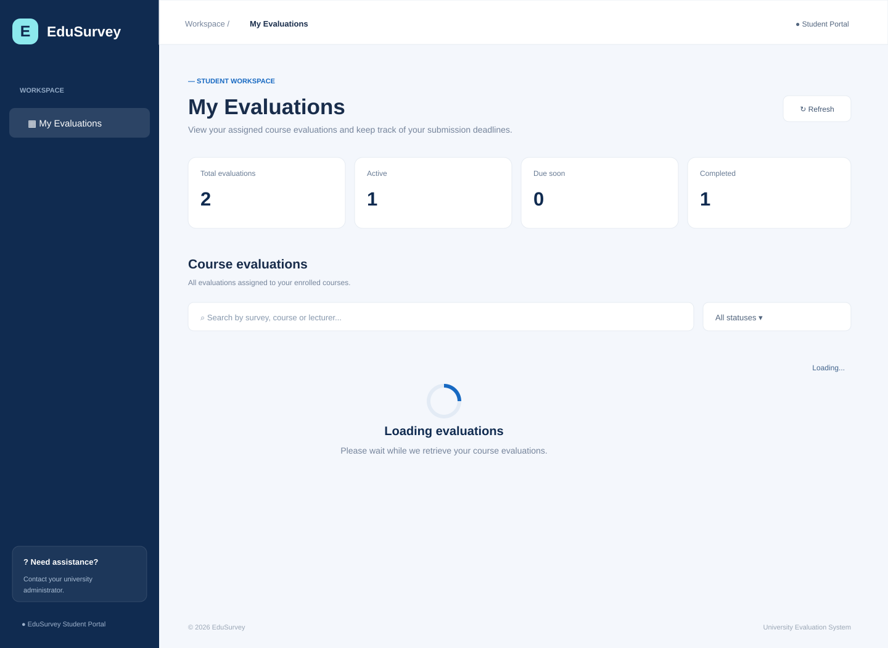
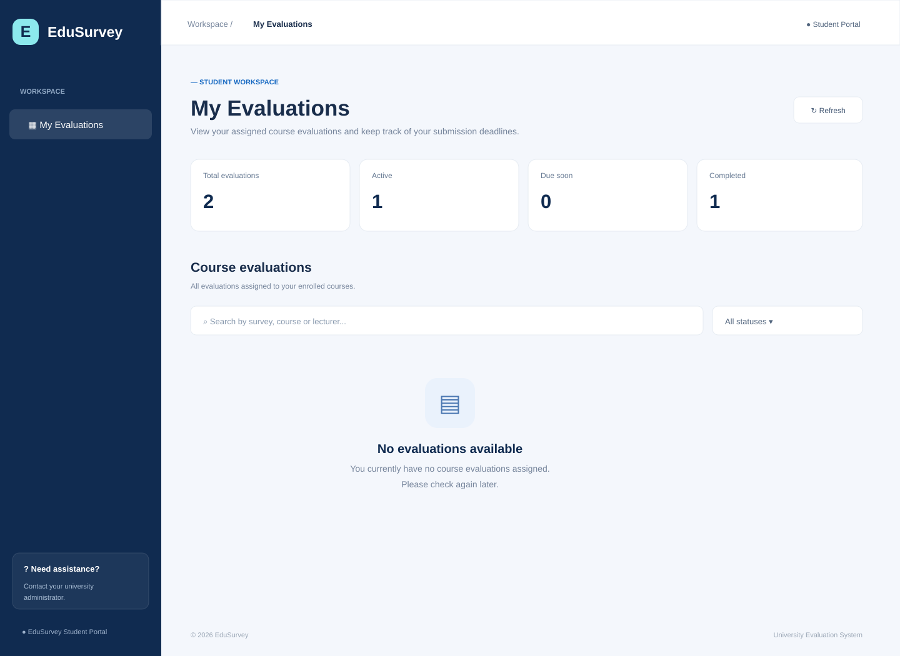
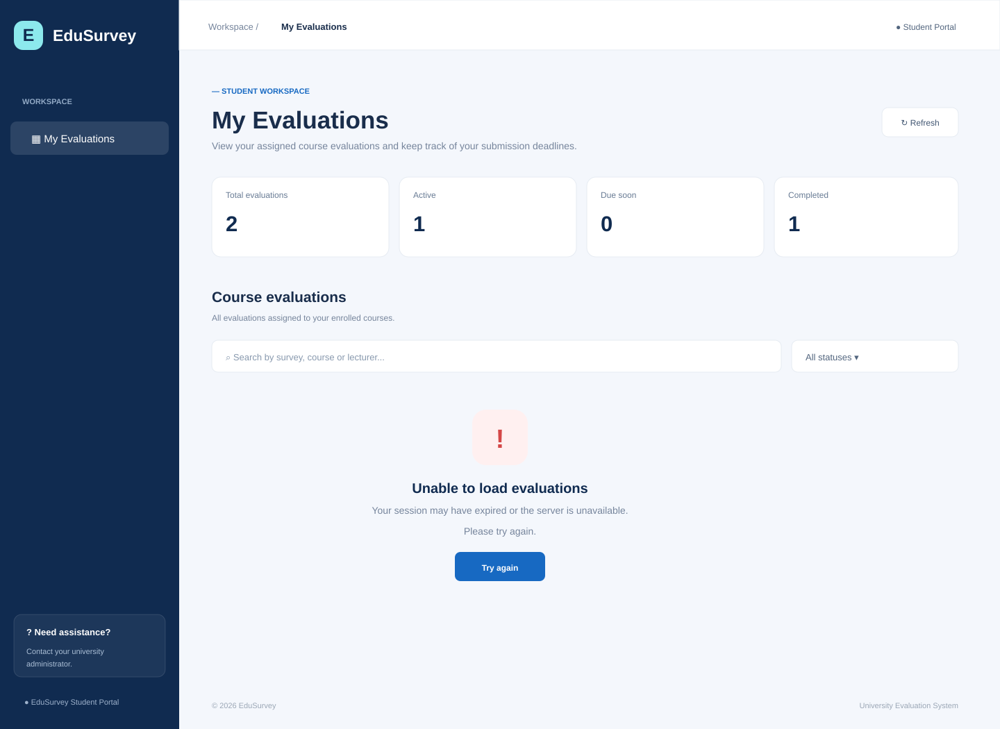

# EduSurvey – Milestone 3 UI Documentation

## 1. P0 Stories, Screens, Routes and Status

### 1.1. Overview

The EduSurvey system includes five P0 user stories for Milestone 3. These stories cover user authentication, student evaluation management, evaluation submission, lecturer feedback review, and user sign-out.

This section documents the screens, routes, API endpoints, implementation status, and related GitHub issues for each P0 user story.

### 1.2. P0 User Story Summary

| User Story | Description | Priority |
|---|---|---|
| US01 | User Login and Authentication | P0 |
| US02 | View Available Course Evaluations | P0 |
| US03 | Complete and Submit Course Evaluation | P0 |
| US04 | Review Submitted Student Feedback | P0 |
| US11 | User Sign Out | P0 |

### 1.3. Screen and Route Mapping

#### US01 – User Login and Authentication

**Purpose:** Allow registered users to authenticate using their university email and password and access authorized system functions.

| Item | Description |
|---|---|
| Screen | Login |
| Page route | `/login` |
| Login API | `POST /api/auth/login` |
| Session API | `GET /api/auth/me` |
| UI issue | #15 |
| Parent Story | #14 |
| Status | Works |

**Main UI components:**

- University email input.
- Password input.
- Show/hide password control.
- Sign-in button.
- User-facing authentication error message.

**Expected behavior:**

The system validates user credentials, establishes an authenticated session, and identifies the user's role.

#### US02 – View Available Course Evaluations

**Purpose:** Allow students to view assigned course evaluations, check submission deadlines, and identify evaluations that require completion.

| Item | Description |
|---|---|
| Screen | My Evaluations |
| Page route | `/evaluations` |
| Data API | `GET /api/evaluations` |
| UI issue | #19 |
| Parent Story | #18 |
| Status | Works |

**Main UI components:**

- Evaluation cards.
- Survey title.
- Course name.
- Lecturer name.
- Submission deadline.
- Evaluation status.
- Search input.
- Status filter.
- Refresh button.

**Supported evaluation states:**

| State | Description |
|---|---|
| Active | Evaluation is open and has more than 24 hours remaining. |
| Due soon | Unfinished evaluation has less than 24 hours remaining. |
| Completed | Student has successfully submitted the evaluation. |
| Closed | Evaluation is closed or its deadline has passed. |

**Expected behavior:**

Students can search and filter evaluations and select an available evaluation to start answering questions.

#### US03 – Complete and Submit Course Evaluation

**Purpose:** Allow students to answer evaluation questions, review their responses, and submit feedback before the deadline.

| Item | Description |
|---|---|
| Screen | Complete Evaluation |
| Page route | `/evaluations/<evaluation_id>/complete` |
| Questions API | `GET /api/evaluations/<evaluation_id>/questions` |
| Submission API | `POST /api/submissions` |
| UI issue | #23 |
| Parent Story | #22 |
| Status | Works |

**Main UI components:**

- Evaluation title and course information.
- Rating-based questions.
- Text-based questions.
- Required-question indicators.
- Completion progress bar.
- Answer validation.
- Review answers dialog.
- Submit evaluation button.
- Submission confirmation.

**Expected behavior:**

1. Load questions belonging to the selected evaluation.
2. Allow students to provide ratings and written comments.
3. Validate required questions.
4. Display the answer review dialog.
5. Submit responses to the backend.
6. Save responses in the database.
7. Prevent duplicate submissions.

#### US04 – Review Submitted Student Feedback

**Purpose:** Allow lecturers to retrieve submitted student feedback for courses they are assigned to teach.

| Item | Description |
|---|---|
| Screen | Lecturer Course Feedback |
| Proposed page route | `/lecturer/feedback` |
| Main API | `GET /api/courses/<course_id>/feedback` |
| Supporting API | `GET /api/evaluations/<evaluation_id>/statistics` |
| Supporting API | `GET /api/evaluations/<evaluation_id>/feedback/topics` |
| Supporting API | `GET /api/evaluations/<evaluation_id>/feedback/topics/ranking` |
| API issue | #51 |
| Parent Story | #50 |
| Status | Partly works |

**Available backend functionality:**

- Retrieve submitted feedback for a course.
- Retrieve student ratings and written comments.
- Calculate the number of completed evaluations.
- Verify lecturer course ownership.
- Reject unauthorized access attempts.

**Current implementation limitation:**

The backend feedback retrieval API is implemented, but the lecturer-facing feedback page has not yet been implemented in the supplied repository snapshot.

Therefore, the proposed lecturer feedback screen will be documented as a wireframe, not as a completed UI feature.

#### US11 – User Sign Out

**Purpose:** Allow authenticated users to securely terminate their current session.

| Item | Description |
|---|---|
| Screen | Sign-out action in authenticated navigation |
| API | `POST /api/auth/logout` |
| Parent Story | US11 in `docs/requirements.md` |
| Status | Partly works |

**Available functionality:**

- Logout endpoint.
- Session termination using `session.clear()`.
- API response indicating that the user is no longer authenticated.

**Current implementation limitation:**

The logout API exists, but the supplied student templates do not currently include a visible sign-out button.

The sign-out control and its navigation behavior will therefore be represented as a proposed UI wireframe.

### 1.4. Implementation Status Summary

| User Story | Backend | Frontend | Overall |
|---|---|---|---|
| US01 | Implemented | Implemented | Works |
| US02 | Implemented | Implemented | Works |
| US03 | Implemented | Implemented | Works |
| US04 | Implemented | Not implemented | Partly works |
| US11 | Implemented | Not implemented | Partly works |

*Implementation status is based on the supplied source-code snapshot, not on PR merge status.*

## 2. Screen Flow and Wireframes

### 2.1. Updated Screen Flow Diagram

The screen flow diagram illustrates how users navigate through the EduSurvey system. It describes the main interactions between students, lecturers, and the authentication system.

The updated flow reflects the implemented M3 routes and API interactions.

#### Screen Flow## 2. Screen Flow and Wireframes

### 2.1. Updated Screen Flow Diagram

The screen flow diagram illustrates how users navigate through the EduSurvey system. It describes the main interactions between students, lecturers, and the authentication system.

The updated flow reflects the implemented M3 routes and API interactions.

#### Screen Flow

#### Screen Navigation and API Mapping

| User action | Screen / destination | API endpoint |
|---|---|---|
| Sign in | Login | `POST /api/auth/login` |
| Check session | Authentication | `GET /api/auth/me` |
| View evaluations | My Evaluations | `GET /api/evaluations` |
| Open evaluation | Complete Evaluation | `GET /api/evaluations/<id>/questions` |
| Submit answers | Submission | `POST /api/submissions` |
| View course feedback | Lecturer Course Feedback | `GET /api/courses/<id>/feedback` |
| Sign out | Login | `POST /api/auth/logout` |

**Implementation notes:**

- Students can only access their assigned course evaluations.
- Students must complete all required questions before submitting.
- Submitted evaluations cannot be submitted again.
- Lecturers can only retrieve feedback for courses assigned to them.
- Unauthorized lecturer access is rejected by the backend.
- The lecturer feedback page and administrator interface are not included in the current implemented frontend scope.

The diagram represents the intended system navigation while distinguishing implemented functionality from planned screens.

#### Screen Navigation and API Mapping

| User action | Screen / destination | API endpoint |
|---|---|---|
| Sign in | Login | `POST /api/auth/login` |
| Check session | Authentication | `GET /api/auth/me` |
| View evaluations | My Evaluations | `GET /api/evaluations` |
| Open evaluation | Complete Evaluation | `GET /api/evaluations/<id>/questions` |
| Submit answers | Submission | `POST /api/submissions` |
| View course feedback | Lecturer Course Feedback | `GET /api/courses/<id>/feedback` |
| Sign out | Login | `POST /api/auth/logout` |

**Implementation notes:**

- Students can only access their assigned course evaluations.
- Students must complete all required questions before submitting.
- Submitted evaluations cannot be submitted again.
- Lecturers can only retrieve feedback for courses assigned to them.
- Unauthorized lecturer access is rejected by the backend.
- The lecturer feedback page and administrator interface are not included in the current implemented frontend scope.

The diagram represents the intended system navigation while distinguishing implemented functionality from planned screens.

### 2.2. Wireframes

#### 2.2.1. US02 – My Evaluations

**Purpose:** Allow students to view assigned course evaluations, monitor deadlines, search and filter surveys, and start an available evaluation.

**Route:** `GET /evaluations`

**API:** `GET /api/evaluations`

**Related UI Issue:** #19

**Parent Story:** #18

##### Data State

##### Loading State

##### Empty State

##### Error State

